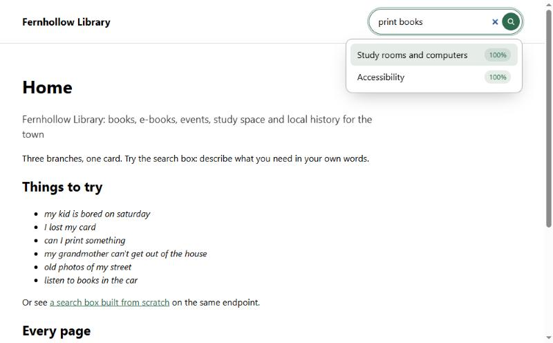
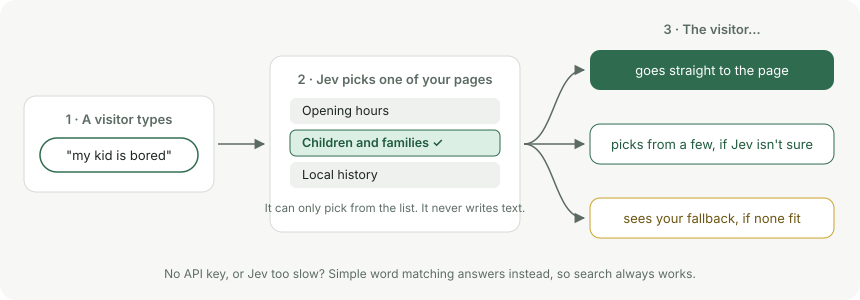
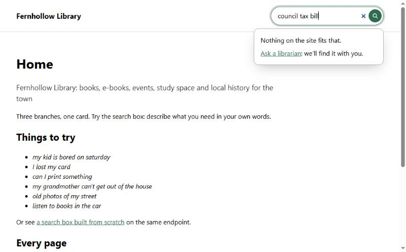
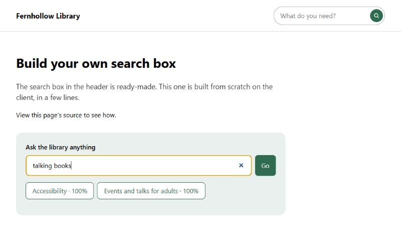

# Wayfinder

**Jev-powered search for websites.** Visitors type what they need in their own words and go straight to the right page, with no list of results to dig through.



> Typing *"my kid is bored on Saturday"* takes you to the children's events page. Typing *"I lost my card"* takes you to the page about replacing a library card.

## Why it's different

- **It goes to one page.** Normal site search gives you ten links and wishes you luck. Wayfinder picks the best one and takes you there.
- **It can't make things up.** The AI ([Jev](https://openrouter.ai/docs/guides/community/jev), through OpenRouter) only *chooses* from your list of pages. It never writes answers, so it can't invent anything or be talked into sending people somewhere else.
- **It always works.** With no API key, or if the AI is slow, simple word matching answers instead.
- **It's private.** Searches are never logged or stored, and the AI provider isn't allowed to keep them either.



## Set it up in three steps

**1. Install it.**

```bash
npm install wayfinder-search
```

**2. Tell it about your pages, and add a search endpoint.** Describe each page the way your visitors would ask for it. Here's a Next.js route at `app/api/search/route.ts`:

```ts
import { createWayfinder } from "wayfinder-search";

const wayfinder = createWayfinder({
  apiKey: process.env.OPENROUTER_API_KEY, // Optional: without it, word matching is used.
  pages: [
    { href: "/join", title: "Join the library", about: "Get a library card, or replace a lost one" },
    { href: "/hours", title: "Opening hours", about: "When we're open, bank holidays, parking" },
    { href: "/kids", title: "Children's events", about: "Story time, craft clubs, things to do at weekends" },
  ],
});

export const POST = wayfinder.handle;
```

On Express it's one line too: `app.post("/api/search", wayfinder.node)`. For Hono, Bun, Deno and others, see [the guide](docs/GUIDE.md#your-server).

**3. Add the search box to your page.** Load it once in your site's JavaScript:

```js
import "wayfinder-search/element";
```

Then put it wherever you want it:

```html
<wayfinder-search endpoint="/api/search" suggest>
  <p slot="none">Can't find it? <a href="/contact">Ask us</a>.</p>
</wayfinder-search>
```

That's it. Whatever you put in `slot="none"` shows up when no page fits.



## Try the demo

The demo is a made-up public library with 11 pages. It needs Node 22.18 or later.

```bash
pnpm install
pnpm demo
```

Then open <http://localhost:3000>. It works without a key. To try it with Jev, copy `.env.example` to `.env` and add your [OpenRouter key](https://openrouter.ai/keys).

## Make it yours

**Change the wording.** Set any of these on the search box: `label`, `placeholder`, `none-label`, `unsure-label`, `error-label`.

**Change the colours.**

```css
wayfinder-search {
  --wayfinder-accent: #7c3aed;
  --wayfinder-radius: 8px;
}
```

**Use your own design.** Add `unstyled` to drop the built-in look and style every piece yourself. To build a completely custom search bar and dropdown, in any framework, use the client:



```js
import { createSearch } from "wayfinder-search/client";

const search = createSearch({ endpoint: "/api/search", suggest: true });

input.addEventListener("input", () => search.type(input.value));
form.addEventListener("submit", (event) => {
  event.preventDefault();
  search.submit(input.value);
});
search.subscribe((state) => {
  // Draw state.suggestions, state.status and state.pages however you like.
});
```

[The guide](docs/GUIDE.md#build-your-own-search-box) has the details and a React example.

## Suggestions and your API bill

With `suggest`, the box lists matching pages (70% match or better) while people type. Every list costs an API call, so Wayfinder holds back:

- it waits until typing pauses,
- it waits at least **2 seconds** between calls (change it with `suggest-cooldown="5000"`),
- it remembers what it already asked, and needs 3 or more characters.

Pressing Enter always searches straight away.

## Good to know

- **Best for about 10 to 100 pages.** Every page description goes into every request. List the pages people actually look for, not every page you have.
- **Keep your API key on the server.** The search box only talks to your endpoint, never to the AI directly.
- **The word matching is basic.** It's a safety net so search keeps working, not a replacement for Jev.

## More

- [The full guide](docs/GUIDE.md): every option, other servers, custom search boxes, writing your own AI provider.
- [MIT licence](LICENSE)
